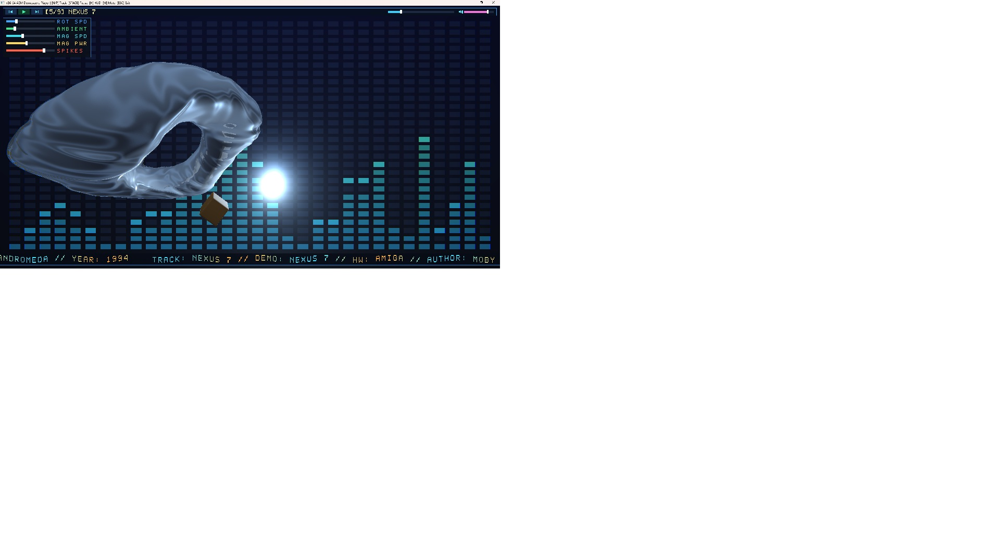

# Chrome Torus — Win64 x86-64 Assembly & GLSL Demoscene Music Player


-success)

An old-school demoscene visualizer and MP3 music player written in pure **Win64 x86-64 Assembly (NASM)** with zero external libraries and no C runtime. The entire 3D scene, 32-channel LED spectrum analyzer, sine-wave scroller, and interactive UI are rendered in real time by a single embedded **GLSL 1.20 fragment shader**.

## Features

* **Real-Time SDF Raymarching (GLSL 1.20):** Space-warped, bending, and undulating chrome torus featuring organic gyroid surface displacement, bass-reactive spikes, self-reflections, soft shadows, Ambient Occlusion, and an orbiting light source with a companion rounded cube.
* **Single-Pass GPU Optimization:** Bounding-sphere early-out, 4-tap tetrahedral surface normals, and hardware screen-space derivative (`dFdx`/`dFdy`) chromatic aberration for smooth, high-FPS playback even at fullscreen resolutions.
* **32-Channel Background LED VU Meter:** 28-segment demoscene spectrum analyzer with peak-hold indicators.
* **Built-In MP3 Player (Windows MCI):** Automatically scans `music\*.mp3` (up to 32 tracks), auto-advances through the playlist, and provides an interactive top player bar (Prev, Play/Pause, Next, interactive Seek bar, Mute toggle, and Volume slider).
* **Sine-Wave Scroller & Shader-Baked 5×7 Bitmap Font:** Crisp bitmap typography packed into `vec4` uniform arrays. Automatically recognizes metadata for 8 classic Amiga/PC demoscene tracks and falls back to displaying the filename for any other MP3.
* **Live HUD Parameter Tweaking:** Press `[H]` to toggle 5 real-time visual sliders (`ROT SPD`, `AMBIENT`, `MAG SPD`, `MAG PWR`, `SPIKES`) to adjust geometry and lighting on the fly.

## Controls

### Keyboard
| Key | Action |
| :--- | :--- |
| `SPACE` | Play / Pause |
| `N` or `Right Arrow` | Next track |
| `P` or `Left Arrow` | Previous track |
| `H` | Toggle parameter HUD panel |
| `M` | Mute / Unmute audio |
| `ESC` | Exit |

### Mouse
* **Top Player Bar:** Click `Prev`, `Play/Pause`, `Next`, or the speaker icon to mute; click and drag along the **Seek** and **Volume** bars.
* **HUD Panel (`[H]`):** Click and drag any of the 5 effect sliders to adjust parameters in real time.

## Directory Structure

```text
.
├── torus_gpu.asm      # Complete Win64 x86-64 NASM source + embedded GLSL shader
├── torus_gpu.exe      # Compiled executable
└── music/             # Place your .mp3 files here

```

## Building from Source
Requires NASM and a Windows x64 linker (such as MinGW-w64 ld or gcc).
1. Assemble to object file (NASM):
```
nasm -f win64 torus_gpu.asm -o torus_gpu.obj Assemble to object file (NASM):
```
2. Link (Zero-CRT, pure Win32 system DLLs):
```
ld torus_gpu.obj -o torus_gpu.exe --subsystem windows -e WinMain -lkernel32 -luser32 -lgdi32 -lopengl32 -lwinmm
```

## Built-In Demoscene Tracklist Recognition

If an MP3 filename inside the `music/` directory contains any of the following keywords (case- and separator-insensitive), the scroller automatically displays its full demoscene credits:

| Track | Demo | Platform | Author | Group | Year |
| :--- | :--- | :--- | :--- | :--- | :--- |
| **State of the Art** | State of the Art | Amiga | Travolta | Spaceballs | 1992 |
| **Stardust** | Stardust | PC | Skaven | Future Crew | 1992 |
| **Second Reality II** | Second Reality | PC | Purple Motion & Skaven | Future Crew | 1993 |
| **Cyberride** | Extension | Amiga | Jester (Sanity) | Pygmy Projects | 1993 |
| **The Decalogue** | Crystal Dream 2 | PC | Vogue | Triton | 1993 |
| **Aglow** | Mindflow | Amiga | Strobo | Stellar | 1994 |
| **Nexus 7** | Nexus 7 | Amiga | Moby | Andromeda | 1994 |
| **Livin' Insanity** | FastTracker 2 | PC | Dune | Orange / Rebels | 1996 |


## License
This project is dedicated to the Public Domain (Unlicense). Feel free to use, modify, and distribute it without restriction.


